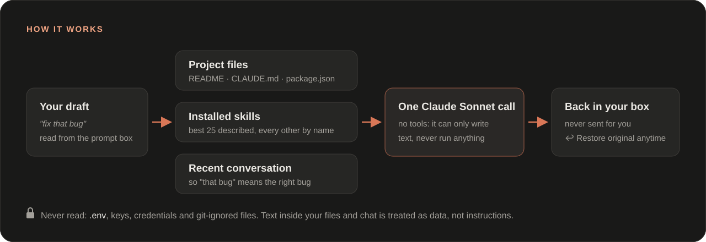

<p align="center">
  
</p>

<p align="center">
  
  
  
  
  <a href="https://github.com/nonputtipong/claude-code-prompt-enhancer/actions/workflows/ci.yml"></a>
</p>

<p align="center">
  Write a rough prompt, click <b>✻ Enhance</b>, and get a clear, specific prompt back in the same box,<br>
  shaped by your project, your installed skills and the conversation so far. You review it, then press Send.
</p>

<p align="center">
  
</p>

> [!NOTE]
> Prompt Enhancer is a Claude Code **mod** and needs **Claude Code 2.1.296+**. It works in the Claude Desktop app's Code tab and in the terminal. In a brand-new Desktop session the button appears after your first message, because that's when the Desktop app starts the part of Claude Code that runs mods.

---

## Installation

The repo is its own plugin marketplace. In a terminal:

```bash
claude plugin marketplace add nonputtipong/claude-code-prompt-enhancer
claude plugin install prompt-enhancer@prompt-enhancer
```

Or inside any Claude Code session, in one step:

```text
/plugin install prompt-enhancer --marketplace nonputtipong/claude-code-prompt-enhancer
```

Then start a new session, or run `/reload-plugins`. The **✻ Enhance** button appears in the strip just above the prompt box.

## How to use it

1. **Write** a rough draft in the prompt box, e.g. `make this website look better`.
2. **Click ✻ Enhance.** The star pulses while it works (usually 3–4 seconds).
3. **Review** the rewritten prompt. Edit it if you like, or click **↩ Restore original** to get your draft back.
4. **Send** it as you normally would. Prompt Enhancer never sends anything for you.

## Features

- **Rewrites, never runs.** One model call with no tools turns your draft into a better prompt. Nothing in the draft is carried out, and nothing is sent.
- **Fits the task.** A simple request becomes one or two polished sentences; a big one gets requirements, constraints and how to verify the result. Rewrites don't get longer for the sake of it.
- **Knows your project.** Reads the top-level layout, `CLAUDE.md` / `AGENTS.md`, the README and manifests like `package.json`, so the prompt names your real framework and conventions.
- **Knows your skills.** Suggests installed skills that fit, by their exact `/name`, and never invents one.
- **Follows the conversation.** Drafts like "fix that bug" or "do the same for the other page" are rewritten to say what they refer to.
- **Flags big decisions.** For architecture, dependencies, security or cost, the prompt asks Claude to show options and wait for your approval; small choices are left to sensible defaults.
- **Never loses your text.** Empty drafts are left alone, failures keep your draft, edits you make while it works are kept, and **↩ Restore original** undoes an enhancement.
- **Shows what it used.** After each run a short message reports tokens and time, e.g. `enhanced · 7.6k in / 367 out tokens · 3.8 s`.

## How it works

<p align="center">
  
</p>

## Privacy and safety

- Files that look like secrets (`.env`, keys, certificates, credentials) and git-ignored files are never read or listed.
- Everything taken from your files and conversation is passed to the model as data, with instructions to ignore any commands hidden in it.
- The enhancement call has no tools, so it can't read further files, run commands or change anything.
- Nothing leaves your machine except that one request, which goes through your own Claude Code account like any other.

## Cost and speed

Each click is one Claude Sonnet request on your own Claude Code account, so it counts towards your usage like any other request. A typical click uses about 7–8k input tokens and takes 3–4 seconds, measured with ~250 installed skills. To keep it light, only the ~25 skills that best match your draft are sent with descriptions; the rest are listed by name only. The recent conversation adds at most about 3,000 tokens: the last 8 messages, each cut to 1,500 characters, with tool output left out.

## Limitations

- The button lives in the strip **above** the prompt box. Claude Code's mod system has no slot in the toolbar below it, and the Desktop app draws the strip's background and the button's style itself.
- The strip steps aside while Claude Code shows a question box above the prompt.
- In a brand-new Desktop session the button appears only after the first message; the terminal shows it immediately.

## Customizing

Everything about how prompts are rewritten lives in [`plugins/prompt-enhancer/hooks/engine.ts`](plugins/prompt-enhancer/hooks/engine.ts):

- `SYSTEM`: the instruction that tells the model how to rewrite.
- `MODEL`: `sonnet` by default. `haiku` is faster and cheaper; `opus` is more thorough and slower.

## Update, disable, uninstall

```bash
claude plugin marketplace update prompt-enhancer   # fetch the latest version
claude plugin disable prompt-enhancer@prompt-enhancer
claude plugin enable prompt-enhancer@prompt-enhancer
claude plugin uninstall prompt-enhancer@prompt-enhancer
claude plugin marketplace remove prompt-enhancer
```

After an update, run `/reload-plugins` or start a new session.

## Contributing

Issues and pull requests are welcome. To work on it locally:

```bash
git clone https://github.com/nonputtipong/claude-code-prompt-enhancer
cd claude-code-prompt-enhancer
claude plugin marketplace add .
claude plugin install prompt-enhancer@prompt-enhancer
git config core.hooksPath .githooks   # validate and test before each commit
```

A plugin installed from a local folder runs straight from that folder, so after an edit `/reload-plugins` is all you need. Run the tests with:

```bash
claude plugin test plugins/prompt-enhancer
```

CI validates the plugin and runs the tests on Linux, macOS and Windows for every change.

```
.claude-plugin/marketplace.json     marketplace entry for this repo
plugins/prompt-enhancer/
  .claude-plugin/plugin.json        mod manifest
  hooks/register.tsx                the button, draft handling, project, skill and conversation lookup
  hooks/engine.ts                   the rewrite instruction and pure helpers
  types/index.d.ts                  the mod's state contract
  tests/enhance.test.tsx            tests
media/                              README graphics
```

## License

[MIT](LICENSE)
